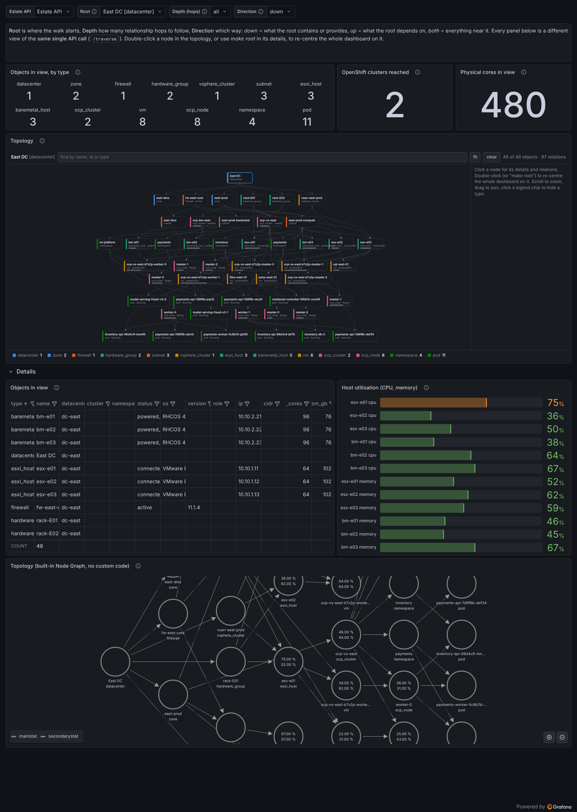

# Estate Explorer

One interactive Grafana dashboard for the whole infrastructure estate: datacenters,
zones, subnets, firewalls, racks, ESXi and bare-metal hosts, VMs, OpenShift clusters,
nodes, namespaces and pods, read from the relationship API in front of YugabyteDB.

Pick a **root** object, a **depth** and a **direction**; every panel is a different
view of the same traversal call. Double-click a node in the topology to make it the
new root and the whole dashboard re-centres on it.



## How it works

```
 dashboard variables   root = dc-east   depth = all   direction = down
          │
          ▼
 "Objects in view" (table, Infinity data source)                      ← the ONLY panel that calls the API
    query A  GET <api>/traverse?root=$root&depth=$depth&direction=$direction   → $.nodes
    query B  GET <api>/traverse?root=$root&depth=$depth&direction=$direction   → $.edges
          │   rows: nodes(id, type, name, attributes…)   edges(id, source, target, relation)
          │
          │   "-- Dashboard --" data source: re-use panel 1's rows, 0 extra calls
          ├── Stat        objects in view, by type           (group by type)
          ├── Stat        OpenShift clusters reached         (distinct `cluster` of the ocp_node rows)
          ├── Stat        physical cores in view             (sum cpu_cores of hosts)
          ├── Bar gauge   host utilisation                   (cpu/mem % of hosts)
          ├── Topology    HTML Graphics panel                (panel/estate-graph.*)
          └── Node Graph  built-in panel, no custom code

 variable "root":  GET <api>/nodes?type=datacenter,zone,subnet,…   once per dashboard load
```

**API calls per refresh: 2** (nodes and edges, same URL), plus 1 for the root
drop-down when the dashboard loads. A refresh happens on load, when a variable changes,
or on a manual refresh; auto-refresh is off because the inventory does not change by the
second. Run the mock API and watch its log: it prints one line per call.

Everything after the source panel is a Grafana *transformation* over the same rows
(filter by type, group by, rename), so new questions are new panels, not new queries.

## Files

| Path | What it is |
|---|---|
| [`../dashboards/estate/estate-explorer.json`](../dashboards/estate/estate-explorer.json) | The importable dashboard (generated; do not edit by hand) |
| [`dashboard.src.json`](dashboard.src.json) | Dashboard source; `{"$file": …}` placeholders pull in the panel files |
| [`panel/estate-graph.html`](panel/estate-graph.html), [`.css`](panel/estate-graph.css), [`.js`](panel/estate-graph.js) | The topology panel: plain SVG + vanilla JS, no libraries, no CDN |
| [`build_dashboard.py`](build_dashboard.py) | Inlines the panel files into the dashboard JSON (`--check` in CI) |
| [`mock/estate-sample.json`](mock/estate-sample.json) | A small, consistent estate: 2 datacenters, 70 objects, 123 relationships |
| [`mock/generate_sample.py`](mock/generate_sample.py) | Regenerates the sample (edit it to grow or reshape the estate) |
| [`mock/mock_api.py`](mock/mock_api.py) | Stand-in for the relationship API (stdlib only) |
| [`mock/test_mock_api.py`](mock/test_mock_api.py) | Tests for the mock and the sample data |
| [`dev/docker-compose.yml`](dev/docker-compose.yml), [`dev/provisioning/`](dev/provisioning) | Local Grafana + plugins + mock, dashboard provisioned from this checkout |

## Run it locally

```bash
cd grafana/estate/dev && docker compose up
```

Then open <http://localhost:3000/d/estate-explorer> (admin / admin). The mock API log
(`docker compose logs -f mock-api`) shows every call Grafana makes.

Without Docker: run `python3 grafana/estate/mock/mock_api.py --bind 0.0.0.0` on a host
the Grafana server can reach, add an **Infinity** data source whose URL is
`http://<that-host>:8099` (allowed hosts: the same), and import
`grafana/dashboards/estate/estate-explorer.json` (Dashboards → New → Import), picking
that data source when asked. Grafana needs the
[Infinity](https://grafana.com/grafana/plugins/yesoreyeram-infinity-datasource/) data
source and the
[HTML graphics](https://grafana.com/grafana/plugins/gapit-htmlgraphics-panel/) panel
installed. Tested on Grafana 12.4 with Infinity 4.1.5 and HTML graphics 2.2.3; it needs
Grafana 11 or newer.

## Point it at the real API

The dashboard never changes between mock and production; only the data source does.

1. **Data source.** Create (or edit) the Infinity data source: URL = the real API's base
   URL, authentication (bearer token, basic, API key, OAuth2) under *Authentication*,
   and the API host under *Allowed hosts*. Queries use URLs relative to that base
   (`/traverse?…`, `/nodes?…`).
2. **Response shape.** The source panel expects:

   ```json
   {
     "nodes": [ {"id": "esx-e01", "type": "esxi_host", "name": "esx-e01", "os": "…", "cpu_cores": 64, "…": "…"} ],
     "edges": [ {"id": "runs:esx-e01>vm-sql-01", "source": "esx-e01", "target": "vm-sql-01", "relation": "runs"} ]
   }
   ```

   `id`, `type`, `name` on every node and `id`, `source`, `target`, `relation` on every
   edge are the contract; every other attribute is optional and simply appears in the
   table, the tooltips and the details pane. Edges point from the container or provider
   to the thing it contains or provides (datacenter → zone, esxi_host → vm,
   ocp_cluster → ocp_node), which is what makes *down* and *up* meaningful.
3. **Different field names?** Edit the two queries of the *Objects in view* panel: each
   column has a *selector* (the field in your response) and a *text* (the name the
   dashboard uses). Change selectors, keep the texts. The same goes for the `root`
   variable (it wants a list with `id` and a human `label`).
4. **Different URL or parameters?** Change the URL in those two queries and in the
   `root` variable; `$root`, `$depth` and `$direction` can go anywhere in it.
5. **Nested tree instead of flat lists?** Ask the API for flat lists if you can; it is
   the simplest contract. Otherwise the Infinity root selector accepts
   [JSONata](https://jsonata.org/), which can flatten nested structures server-side.
6. **Deploy.** Merge to `main`: the `grafana-dashboards` workflow pushes it to Grafana.
   Set the repository variable `GRAFANA_INPUT_DS_INFINITY` to the Infinity data source's
   uid first, otherwise the import binds the dashboard to the default (Prometheus)
   data source and every panel errors.

## Questions it answers

| Question | Root | Direction | Where to look |
|---|---|---|---|
| How many OpenShift clusters run on this subnet? | the subnet | down | *OpenShift clusters reached* |
| What OS do the VMs on this ESXi host run? | the host | down, depth 1 | *Objects in view*, filter type = vm |
| How many pods does app X have on cluster Y / in datacenter Z? | the cluster or datacenter | down | *Objects in view*, filter type = pod and app = X; the footer counts the rows |
| Where does this pod actually run (node, VM, host, rack, subnet, site)? | the pod | up | *Topology* |
| What do we have in this datacenter, and how loaded is it? | the datacenter | down | *Objects by type*, *Physical cores*, *Host utilisation* |
| What is near this object, regardless of direction? | anything | both, depth 2–3 | *Topology* (fans out through hubs such as zones) |

## Editing the topology panel

The panel is three files under `panel/`. `estate-graph.js` is the HTML graphics panel's
*onRender* script: it reads the node and edge frames, lays them out in layers
(containers on top; a layer wider than the panel folds into sub-rows), draws them as
SVG, and handles zoom, pan, selection, search, legend toggles and drill-down
(`locationService.partial({'var-root': id})`). Object types map onto six colour
families; the type name is always printed on the node, so colour is never the only cue.

After editing, run `python3 grafana/estate/build_dashboard.py` and commit both the source
and the generated JSON; CI fails if they drift. With the dev stack running, Grafana
picks the rebuilt dashboard up within ten seconds.

Keep `${…}` out of the JavaScript: Grafana's dashboard import interpolates such
placeholders, so the script uses string concatenation instead of template literals.

## Limits and next steps

- The topology panel is comfortable with a few hundred objects; beyond that use depth,
  a narrower root, or hide types in the legend. The built-in Node Graph gets slow sooner.
- The mock traversal is a plain breadth-first walk. If the real API offers richer
  queries (filters by type, paths between two objects), add them as variables and
  parameters the same way `depth` and `direction` are wired.
- Capacity numbers (cores, memory, utilisation) are whatever the API returns per
  object; planning views such as "free capacity per rack" are a group-by over those
  rows once the attributes exist.
